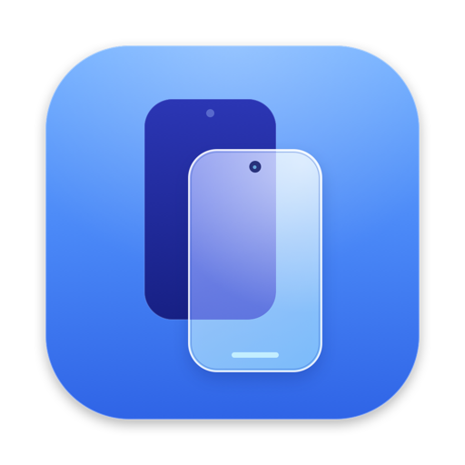

<p align="center"></p>

# AirDoxx

AirDoxx is a native macOS app that mirrors and controls an Android phone, modelled on Apple's iPhone Mirroring. It shows the phone's screen, plays its sound, forwards its notifications and shares its clipboard. You control the phone with your Mac's keyboard and trackpad, and it works wirelessly after a one-time setup.

**Website and setup guide:** https://shanmuckh.github.io/AirDox/

## Download

**[⬇ Download AirDoxx 1.0 for Mac (DMG)](https://github.com/shanmuckh/AirDox/releases/latest/download/AirDoxx.dmg)**

The app is universal (Apple silicon and Intel) and needs macOS 14 Sonoma or later.

1. Open `AirDoxx.dmg` and drag **AirDoxx** into **Applications**.
2. The first launch needs one extra step, because AirDoxx isn't notarized by Apple yet. Open it and click **Done** on the warning. Then go to **System Settings › Privacy & Security**, scroll down and click **Open Anyway**.
3. Follow the welcome screen. It asks for the Mac permissions and helps you connect your phone.

## Features

### Window and display
- Phone-shaped window with a hover toolbar:
  - **Disconnect** (⏻): disconnect, or disconnect permanently to make AirDoxx forget the phone
  - **Screens**: show on both screens, or on the Mac only with the phone's display off
  - **Rotate**: the phone turns 90° in place
  - **Back**, **Home**, **App Switcher**
- 60 fps hardware-decoded video, and phone audio on the Mac (Android 11+).

### Connection
- **Pair once, then wireless:**
  - Plug in once, or scan a QR code from *Wireless debugging › Pair device with QR code*.
  - After that, AirDoxx finds the phone on your Wi-Fi by itself, with no pairing again.

### Phone to Mac
- **Notifications:** phone notifications appear as Mac notifications. Click one to open that app on the phone.
- **Universal Clipboard:** copy on one device and paste on the other, automatically, in both directions.

### Input and Mac keys
- **Gestures:**
  - Click, double-tap, long-press and drag.
  - Two-finger swipes, with Back and Home from the edges.
  - Pinch, and the full keyboard.
- **Mac keys go to the phone:**
  - volume, brightness and media keys
  - F3 for the app switcher
  - F4 for search: the open app's search box if it has one, otherwise the phone's search
  - F5 for the voice assistant
  - ⌥⌘D for Do Not Disturb

### Smart screen handling
- When the phone locks, its own screen turns on for the fingerprint sensor, and you can also type the PIN from the Mac.
- Protected screens (GPay, banking) show a "Continue on your phone" notice.

### Extras
- Drag a file onto the phone to save it to Downloads, or drag an APK to install it.
- ⇧⌘S saves a screenshot to the Desktop.

### Mac-style UI
- An iPhone-Mirroring-style welcome and setup flow with frosted-glass styling.
- The Mac permissions are requested from inside the app.

## Phone setup (one time)
1. Settings › About phone › tap **Build number** 7 times.
2. Settings › Developer options › turn on **USB debugging**.
   - On Xiaomi / HyperOS, also turn on **USB debugging (Security settings)**.
3. Plug the phone in and tap **Allow**, or use **Wireless debugging › Pair device with QR code** (Android 11+).

Developer options are required. AirDoxx controls the phone through Android's debugging interface (adb), and nothing is installed on the phone.

## Build from source
```bash
brew install --cask android-platform-tools
```
```bash
brew install scrcpy
```
```bash
./scripts/build_app.sh --install
```
This builds AirDoxx and installs it in **/Applications**, so it shows up in Finder, Launchpad and Spotlight. The script copies `adb` and the scrcpy server into the app bundle.

To build the release DMG instead, run `./scripts/build_app.sh --release`. It produces a universal app, `build/AirDoxx.dmg` and a SHA-256 checksum.

The app is signed with a self-signed identity kept in `.signing/`, a project-local keychain. This folder is git-ignored. Because the identity stays the same, the Mac permissions survive rebuilds.

## Website
The website lives in `docs/` and is plain HTML, CSS and JavaScript. To publish it with GitHub Pages:
1. Open **Settings › Pages** in the repository.
2. Set **Source** to *Deploy from a branch*.
3. Set **Branch** to `main` and the folder to `/docs`.

## Known limitations
- **Banking and payment apps:** their protected screens can't be mirrored, because Android blocks screen capture of them by design.
- **After a phone reboot:** turn Wireless debugging back on (or plug in once). Android switches it off when the phone restarts.

## How it works
AirDoxx copies the open-source [scrcpy](https://github.com/Genymobile/scrcpy) server (Apache-2.0) to the phone and starts it there. It then talks to the server over an `adb forward` tunnel using scrcpy's v5.0.1 wire protocol.

The protocol client, video and audio pipeline, input, notification bridge, clipboard and UI are all written in Swift.

Code layout:
- `Sources/AirDoxx/Protocol`: the wire format
- `Device`: adb, sessions, pairing, notifications, search and secure-screen detection
- `Media`: video and audio
- `Input`: Mac keys and Now Playing
- `UI`: windows and views
- `App`: app state and menus
